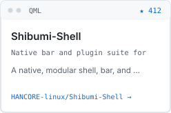
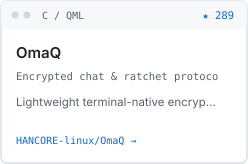
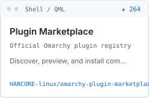
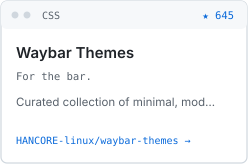
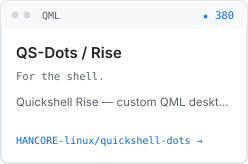

<!-- Generated from portfolio.config.json by scripts/customize.mjs -->

  <picture>
    <source media="(prefers-color-scheme: dark)" srcset="./folio/custom/wordmark-dark.svg" />
    
  </picture>

  <picture>
    <source media="(prefers-color-scheme: dark)" srcset="./folio/custom/bio-dark.svg" />
    
  </picture>

  <a href="https://github.com/HANCORE-linux/Shibumi-Shell"><picture><source media="(prefers-color-scheme: dark)" srcset="./folio/custom/project-shibumi-shell-dark.svg" /></picture></a> <a href="https://github.com/HANCORE-linux/OmaQ"><picture><source media="(prefers-color-scheme: dark)" srcset="./folio/custom/project-omaq-dark.svg" /></picture></a> <a href="https://github.com/omacom/omarchy-plugin-marketplace"><picture><source media="(prefers-color-scheme: dark)" srcset="./folio/custom/project-omarchy-plugin-marketplace-dark.svg" /></picture></a> <a href="https://github.com/HANCORE-linux/waybar-themes"><picture><source media="(prefers-color-scheme: dark)" srcset="./folio/custom/project-waybar-themes-dark.svg" /></picture></a> <a href="https://github.com/HANCORE-linux/quickshell-dots"><picture><source media="(prefers-color-scheme: dark)" srcset="./folio/custom/project-quickshell-dots-dark.svg" /></picture></a>

  <a href="https://github.com/HANCORE-linux?tab=repositories">
    <picture>
      <source media="(prefers-color-scheme: dark)" srcset="./folio/custom/total-stars-dark.svg" />
      
    </picture>
  </a>

